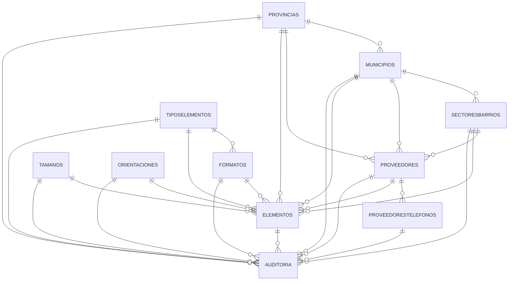

# Diagrama de Relaciones - Base de Datos Elementos (Simplificado)

## Tablas del Sistema

| Tabla | Descripción |
|-------|-------------|
| Provincias | Ubicaciones a nivel provincia |
| Municipios | Ubicaciones a nivel municipio |
| SectoresBarrios | Sectores o barrios dentro de municipios |
| Proveedores | Datos de proveedores/suplidores |
| ProveedoresTelefonos | Teléfonos de contacto de proveedores |
| Orientaciones | Orientaciones geográficas (N, S, E, O) |
| TiposElementos | Clasificación de tipos de elementos |
| Formatos | Formatos dentro de tipos de elementos |
| Tamanos | Tamaños/dimensiones de elementos |
| Elementos | Elementos publicitarios principales |
| Auditoria | Registro de cambios en todas las tablas |
