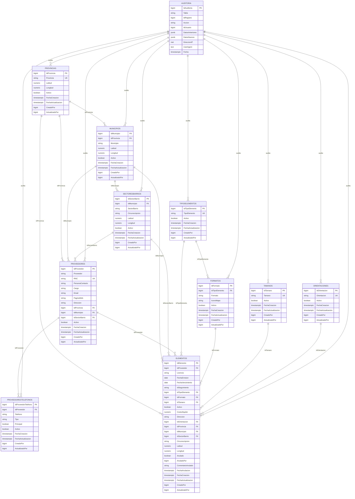

# Diagrama de Relaciones - Base de Datos Elementos

## Descripción General

Este documento muestra las relaciones entre todas las tablas del modelo de datos para gestión de Elementos, Proveedores y ubicaciones geográficas.

## Diagrama ER (Entity Relationship)

## Resumen de Relaciones

### Jerarquía Geográfica
- **Provincias** → **Municipios** (1:N)
- **Municipios** → **SectoresBarrios** (1:N)

### Proveedores y Ubicación
- **Provincias** → **Proveedores** (1:N)
- **Municipios** → **Proveedores** (1:N)
- **SectoresBarrios** → **Proveedores** (1:N)
- **Proveedores** → **ProveedoresTelefonos** (1:N)

### Clasificación de Elementos
- **TiposElementos** → **Formatos** (1:N)
- **TiposElementos** → **Elementos** (1:N)
- **Formatos** → **Elementos** (1:N)
- **Tamanos** → **Elementos** (1:N)
- **Orientaciones** → **Elementos** (1:N)

### Elementos y Ubicación
- **Provincias** → **Elementos** (1:N)
- **Municipios** → **Elementos** (1:N)
- **SectoresBarrios** → **Elementos** (1:N)
- **Proveedores** → **Elementos** (1:N)

### Auditoría
- **Auditoria** registra cambios en todas las tablas (Foreign Keys lógicas)

## Características Principales

### Auditoría Completa
Todas las tablas tienen triggers que registran:
- Fecha de creación y actualización
- Usuario que realizó la acción
- Auditoría detallada con datos anteriores y nuevos

### Anulación Lógica
La tabla **Elementos** soporta anulación lógica con:
- `Anulado` (boolean)
- `AnuladoPor` (usuario)
- `ComentarioAnulado` (motivo)
- `FechaAnulacion` (timestamp)

### Validaciones CHECK
- **Elementos**: `FechaVencimiento >= FechaEmision`
- **Elementos**: `CostoAlquiler >= 0`
- **Elementos**: Coherencia en campos de anulación
- **Auditoria**: Acción debe ser INSERT, UPDATE o DELETE

### Índices Optimizados
Se han creado índices para:
- Claves foráneas (relaciones)
- Búsquedas frecuentes (Proveedor, Licencia, Activo, Anulado)
- Auditoría (Tabla, IdRegistro, IdUsuario, Fecha)
- Ubicación geográfica (Provincia, Municipio, SectorBarrio)
